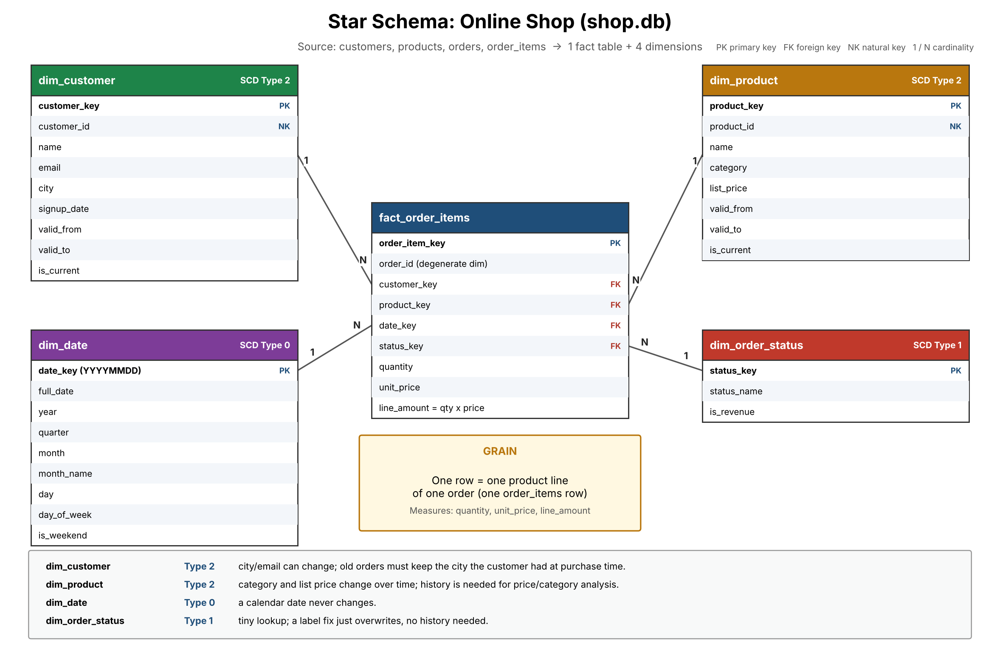

# Star Schema: Online Shop

`shop.db` (customers, products, orders, order_items) ma'lumotlar bazasi uchun **star schema** loyihasi: bitta fakt jadvali va to'rtta dimension.



PDF versiyasi: [star_schema.pdf](star_schema.pdf)

## Fakt jadvali: `fact_order_items`

**Grain (donadorlik):** bitta qator = bitta buyurtmadagi bitta mahsulot pozitsiyasi (manba: `order_items` jadvalining bitta qatori).

| Ustun | Turi | Manba |
|-------|------|-------|
| `order_item_key` | PK (surrogate) | `order_items.order_item_id` |
| `order_id` | degenerate dimension | `order_items.order_id` |
| `customer_key` | FK → `dim_customer` | `orders.customer_id` orqali |
| `product_key` | FK → `dim_product` | `order_items.product_id` orqali |
| `date_key` | FK → `dim_date` | `orders.order_date` |
| `status_key` | FK → `dim_order_status` | `orders.status` |
| `quantity` | o'lchov (measure) | `order_items.quantity` |
| `unit_price` | o'lchov | `order_items.unit_price` |
| `line_amount` | o'lchov | `quantity * unit_price` |

`order_id` alohida dimension jadvaliga chiqarilmagan, chunki unda tavsiflovchi ustunlar yo'q. Bunday ustun **degenerate dimension** deyiladi va faktning o'zida qoladi.

## Dimensionlar va SCD turlari

| Dimension | SCD turi | Sababi |
|-----------|----------|--------|
| `dim_customer` | **Type 2** | Mijozning shahri yoki emaili o'zgarishi mumkin. Eski buyurtmalar mijoz o'sha paytdagi shahrida qolishi kerak, shunda shahar bo'yicha tahlil to'g'ri chiqadi. |
| `dim_product` | **Type 2** | Mahsulot kategoriyasi va narxi vaqt o'tishi bilan o'zgaradi. Narx va kategoriya tarixi tahlil uchun kerak. |
| `dim_date` | **Type 0** | Kalendar sanasi hech qachon o'zgarmaydi. |
| `dim_order_status` | **Type 1** | Kichik lug'at jadvali (`completed`, `shipped`, `cancelled`). Nom tuzatilsa, ustiga yozib qo'yiladi, tarix kerak emas. |

Type 2 jadvallarda `valid_from`, `valid_to`, `is_current` ustunlari bor: o'zgarish bo'lganda eski qator yopiladi va yangi qator qo'shiladi.

## Dimension ustunlari

```
dim_customer:     customer_key PK, customer_id NK, name, email, city, signup_date, valid_from, valid_to, is_current
dim_product:      product_key PK, product_id NK, name, category, list_price, valid_from, valid_to, is_current
dim_date:         date_key PK (YYYYMMDD), full_date, year, quarter, month, month_name, day, day_of_week, is_weekend
dim_order_status: status_key PK, status_name, is_revenue
```

- `NK` (natural key) manba tizimidagi asl identifikator.
- `is_revenue` = `cancelled` uchun `false`, qolganlar uchun `true`. Daromad hisoblashda bekor qilingan buyurtmalarni shu ustun bilan filtrlash mumkin.

## Fayllar

```
.
├── star_schema.png      # diagramma
├── star_schema.pdf      # diagramma (PDF)
├── make_diagram.py      # diagrammani yaratuvchi skript (matplotlib)
└── README.md
```
